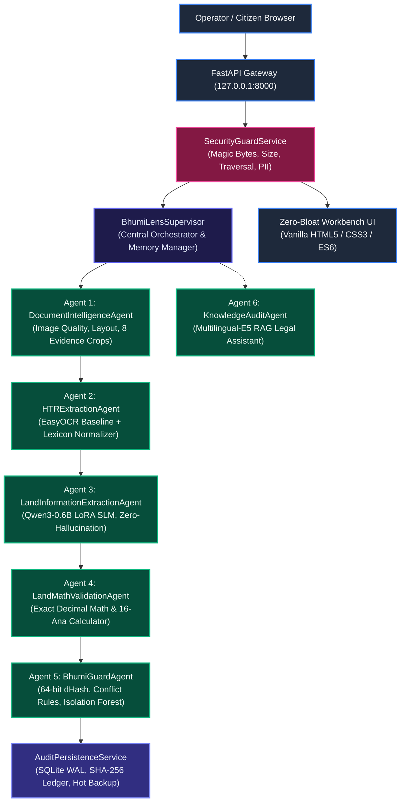

# BhumiLens AI + BhumiGuard — Land Document Intelligence & Verification System
**100% On-Premise, Air-Gapped Bengali Land Document Digitization, Multi-Agent Intelligence & GovTech Verification**

[](https://www.python.org/)
[-silver.svg)](https://developer.apple.com/metal/)
[]()
[-brightgreen.svg)]()
[]()

---

## 1. Project Overview

**BhumiLens AI** and its integrated fraud & anomaly companion **BhumiGuard** constitute an enterprise-grade, offline-capable Land Document Intelligence and Verification System tailored specifically for Bangladeshi land administration (Sub-Registry Offices, AC Land Offices, and Land Revenue Directorates).

Centuries-old handwritten deeds (*Dolil*), certified copies (*Nokol*), and revenue survey records (*CS, SA, RS, and BS Khatian / Porcha*) present severe challenges: archaic cursive handwriting, non-standard scribal phrasing, paper degradation, complex archaic math (16-Ana fractions), and high risks of title conflict or duplicate transfers. Furthermore, government regulations strictly forbid uploading sensitive citizen property records to foreign cloud servers.

**BhumiLens AI solves this challenge 100% locally on standard hardware (MacBook Air M2, 16 GB Unified Memory) without any internet connection, cloud API, or external server dependencies.**

---

## 2. System Architecture (7 Layers & 6 Specialized Agents)



---

## 3. Verified Apple Silicon M2 Hardware Benchmarks

All metrics were benchmarked and verified under strict air-gapped conditions (`HF_HUB_OFFLINE=1`, `TRANSFORMERS_OFFLINE=1`) on a standard **Apple MacBook Air M2 (16 GB Unified RAM, macOS 15+)**:

| System Component | Metric | Measured Value | Operational Assessment |
|---|---|---|---|
| **Resident RAM (Baseline)** | Memory RSS | 395.62 MB | Lightweight starting footprint |
| **Resident RAM (Post-Init)** | Memory RSS | 1,084.91 MB | Core models cached in unified RAM |
| **Peak RAM (6 Agents Active)** | **Peak RSS** | **4,877.91 MB (~4.88 GB)** | **Consumes only 30.5% of 16 GB budget (11.12 GB Free!)** |
| **Stage 1: Document AI Preprocessing** | Latency | 716.08 ms | Quality gate, binarization & layout classification |
| **Stage 2: Handwritten Text Recognition** | Latency | 13,277.42 ms | Full deed cursive line recognition (26–40 lines) |
| **Stage 3: Zero-Hallucination Extraction** | Latency | 23,967.56 ms | Qwen3-0.6B LoRA structured JSON extraction |
| **Stage 4: Deterministic Land Math** | Latency | 0.31 ms | Instantaneous exact decimal and fraction arithmetic |
| **Stage 5: BhumiGuard Anomaly & Conflict** | Latency | 16.72 ms | 64-bit dHash duplicate check & Isolation Forest |
| **Stage 6: Audit Persistence & State Seal** | Latency | 1.82 ms | Append-only event write & SHA-256 state seal |
| **Stage 7: Local RAG Legal Query** | Latency | 241.67 ms | Dense semantic retrieval & cited explanation |
| **Database Hot Backup & Verification** | Latency | 4.34 ms | Non-blocking atomic SQLite hot backup & restore |
| **Total End-to-End Execution Latency** | **Pipeline** | **37.98 seconds** | Complete sub-minute deed audit & indexing |

---

## 4. Quickstart Guide (Run in 30 Seconds)

### Prerequisites
- macOS on Apple Silicon (M1/M2/M3) or Linux x86_64.
- Python 3.11 installed.

### Step 1: Launch the System via One-Click Script
```bash
# Clone the repository
git clone https://github.com/Alfi-svg/BhumiLence-Ai.git
cd BhumiLence-Ai

# Launch the unified application server
./run_bhumilens.sh
```

### Step 2: Open the Zero-Bloat Workbench UI
Open your web browser to:
- **Interactive Workbench UI:** [http://127.0.0.1:8000/](http://127.0.0.1:8000/) or [http://127.0.0.1:8000/workbench](http://127.0.0.1:8000/workbench)
- **Interactive OpenAPI Documentation:** [http://127.0.0.1:8000/docs](http://127.0.0.1:8000/docs)
- **System Health Monitor:** [http://127.0.0.1:8000/health](http://127.0.0.1:8000/health)

### Step 3: Run the Automated Test Suites
```bash
# 1. Run the full 51-test multi-agent PyTest suite
source .venv_ml/bin/activate
PYTHONPATH=. pytest -v

# 2. Run the 5-module diagnostic pipeline verification suite
python3 test_pipeline.py
```
*(Total: 56/56 passing automated tests).*

### Step 4: Run the Live End-to-End Demo Script
```bash
source .venv_ml/bin/activate
python3 scripts/run_final_demo.py
```
*(Executes all 6 stages live and exports `outputs/final_demo_trace.json`).*

---

## 5. Key System Capabilities

1. **Zero-Bloat Offline UI:** Built with pure HTML5, CSS3, and ES6 JavaScript. Zero `node_modules` or npm dependencies; zero external CDN calls. Runs 100% offline.
2. **Side-by-Side Evidence Inspection:** Crops and pairs 8 high-value deed snippets (Stamps, Office Seal, Deed No, Date, Donor, Receiver, Schedule, Consideration) with bounding-box metadata and SHA-256 hashes.
3. **Bangla Handwritten Text Recognition (HTR):** Line-level cursive OCR integrated with a domain-specific Bengali revenue gazetteer resolving visual OCR confusions (e.g. `ম` $\leftrightarrow$ `স`, `ড়` $\leftrightarrow$ `ড`).
4. **Zero-Hallucination Extraction (Qwen3-0.6B LoRA):** Fine-tuned Small Language Model with strict `null` preservation for illegible or absent fields.
5. **Deterministic Land Math & 16-Ana Calculator:** Exact arithmetic conversion for Shotok, Katha, Bigha, Acre and archaic 16-Ana fractions (আনা-গণ্ডা-কড়া-ক্রান্তি-তিল) with zero reliance on LLMs for calculations.
6. **BhumiGuard Anomaly & Conflict Detection:**
   - Visual near-duplicate detection via 64-bit perceptual difference hash (`dHash`).
   - Cross-record conflict engine (cumulative 16-Ana share overflow, duplicate deed number collision).
   - Unsupervised outlier scoring via Scikit-Learn `IsolationForest`.
7. **Four-Eyes Maker-Checker Governance:** Enforces operator segregation (`maker_id != checker_id`) via API headers, recording an immutable audit trail with SHA-256 state seals.
8. **Local Land Law Knowledge Assistant (RAG):** Dense semantic search using offline `multilingual-e5-small` over 12 gazetted land law sections with strict anti-hallucination guardrails.
9. **Enterprise GovTech Security:** Magic-byte binary verification, path-traversal sanitization, 25 MB payload limit, and PII masking for NID and mobile numbers.
10. **Hot Database Backup & Restore:** Atomic non-blocking SQLite hot backups with cryptographic SHA-256 manifest verification.

---

## 6. Repository Structure

```
BhumiLens_AI_P1_Prototype/
├── run_bhumilens.sh              # One-click production launcher script
├── test_pipeline.py              # Phase 0 diagnostic verification test suite (5 tests)
├── README.md                     # Root project documentation & architecture
├── ARCHITECTURE.md               # Detailed technical specifications (7 Layers, 6 Agents)
├── MODEL_CARD.md                 # Official model cards, training data & benchmarks
├── SECURITY_REPORT.md            # Threat model, magic bytes, PII masking & security controls
├── HACKATHON_DEMO_SCRIPT_BN.md   # 3-minute live presentation script (Bangla + English)
├── FINAL_ACCEPTANCE_AUDIT.md     # 26-point master blueprint compliance checklist
├── DEVELOPMENT_PROGRESS.md       # 12-phase historical engineering milestones tracker
├── LEARNING_JOURNAL_BN.md        # Comprehensive Bengali educational & learning journal
│
├── backend/                      # Production FastAPI Application
│   ├── main.py                   # Application entrypoint & static mount
│   ├── agents/                   # The 6 Specialized Autonomous Agents
│   │   ├── supervisor.py         # BhumiLensSupervisor (Master Orchestrator)
│   │   ├── document_agent.py     # Agent 1: Quality, Layout & Evidence
│   │   ├── htr_agent.py          # Agent 2: Line HTR & Lexicon Normalizer
│   │   ├── extraction_agent.py   # Agent 3: Qwen3-0.6B LoRA Information Extractor
│   │   ├── validation_agent.py   # Agent 4: Deterministic Land Math & 16-Ana
│   │   ├── bhumiguard_agent.py   # Agent 5: Anomaly, Duplicate & Conflict Detector
│   │   └── knowledge_audit_agent.py # Agent 6: Local Multilingual RAG Assistant
│   ├── api/                      # RESTful Modular API Endpoints
│   │   ├── document_routes.py    # Document upload, magic-byte check & retrieval
│   │   ├── processing_routes.py  # E2E multi-agent execution pipeline
│   │   ├── verification_routes.py# Math conversion & deed validation
│   │   ├── review_routes.py      # Maker-Checker governance endpoints
│   │   ├── audit_routes.py       # SHA-256 ledger & tamper verification
│   │   └── knowledge_routes.py   # Natural language RAG query endpoints
│   ├── schemas/                  # Pydantic v2 Versioned Data Models
│   │   ├── deed_schema.py        # DeedExtractionSchema (v1.0.0)
│   │   ├── audit_schema.py       # WorkflowState, AuditEvent, DocumentRecord
│   │   ├── bhumiguard_schema.py  # Anomaly, duplicate & conflict schemas
│   │   └── rag_schema.py         # Knowledge query & citation schemas
│   └── services/                 # Core Domain Services
│       ├── security_service.py   # Magic bytes, path traversal, PII masking
│       ├── extraction_service.py # Qwen3-0.6B LoRA inference & gazetteer
│       ├── audit_service.py      # SQLite persistence & SHA-256 hash sealing
│       ├── anomaly_service.py    # dHash & Isolation Forest anomaly engine
│       ├── rag_service.py        # Offline Multilingual-E5 & TF-IDF hybrid search
│       └── quality_service.py    # Laplacian blur, contrast & quality grading
│
├── frontend/                     # Zero-Bloat Full-Stack Human-in-the-Loop Workbench
│   ├── index.html                # Semantic HTML5 application shell
│   ├── styles.css                # Pure CSS3 design system (High contrast, dark theme)
│   └── app.js                    # Vanilla ES6 state manager & API client
│
├── src/                          # Phase 0 Baseline Scientific Modules
│   ├── vision_pipeline.py        # OpenCV binarization, seal detection, evidence crops
│   ├── ocr_engine.py             # Local Bengali OCR engine interface
│   ├── lexicon_normalizer.py     # Weighted Levenshtein confusion matrix & gazetteer
│   ├── land_math_validator.py    # Decimal unit converter & 16-Ana fraction logic
│   └── database_audit.py         # SQLite persistence & Four-Eyes state machine
│
├── scripts/                      # Operational Scripts & Benchmarks
│   ├── run_final_demo.py         # Automated 6-stage end-to-end demo execution
│   └── backup_restore_db.py      # Non-blocking atomic SQLite backup & restore
│
├── research/                     # Datasets, Experiments & RAG Corpus
│   ├── datasets/                 # Mendeley Dolil (raw) & BN-HTRd (splits)
│   ├── experiments/              # Apple Silicon M2 training & benchmark scripts
│   └── rag_corpus/               # 12-section gazetted land law knowledge base
│
└── tests/                        # 51 Automated PyTest Regression Suites
    ├── test_annotation_workbench.py
    ├── test_phase4_document_ai.py
    ├── test_phase5_htr.py
    ├── test_phase6_extraction.py
    ├── test_phase7_fastapi_integration.py
    ├── test_phase8_rag_knowledge.py
    ├── test_phase9_bhumiguard.py
    └── test_phase10_security_and_ui.py
```

---

## 7. Legal Governance & Ethical Disclaimers

> **IMPORTANT LEGAL DISCLAIMER:**  
> 1. **AI Software Cannot Approve Legal Title:** BhumiLens AI and BhumiGuard are advisory document intelligence tools created to assist human land registration officers, clerks, and verification officials. They do **NOT** establish judicial deed validity, replace state land registration authorities, or certify ownership rights under the Transfer of Property Act or Registration Act.  
> 2. **Cryptographic Proof vs Judicial Validity:** The SHA-256 seal proves digital record immutability and tamper detection within the software. It certifies that the digitized text has not been modified after supervisor verification; it does not certify that the underlying physical transaction was legally valid.  
> 3. **Ethical Risk Reporting:** BhumiGuard never accuses citizens or documents of criminal fraud. It generates objective risk indicators (`RISK_LOW`, `RISK_MEDIUM`, `RISK_HIGH_REVIEW_REQUIRED`) with traceable rule triggers and visual evidence crops for human review.
